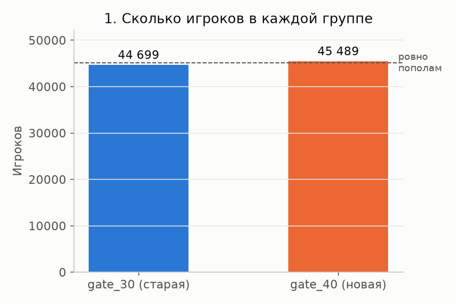
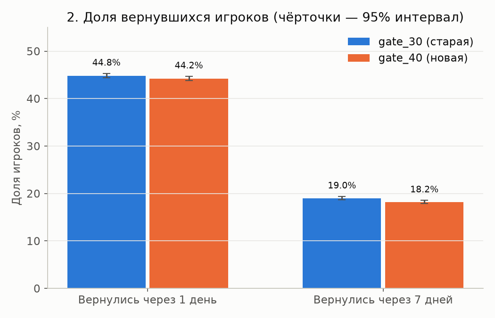
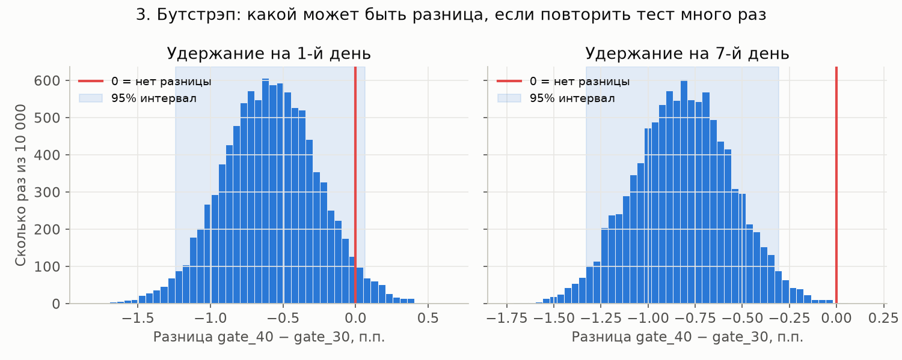
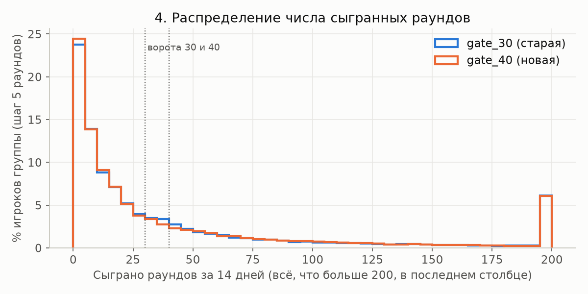

# Разбор A/B-теста Cookie Cats

В мобильной игре Cookie Cats на некоторых уровнях стоят «ворота»: игра просит подождать или заплатить, чтобы играть дальше. Разработчики перенесли первые ворота с 30-го уровня на 40-й для половины игроков и посмотрели, сколько людей возвращается в игру. Я разобрала результаты этого A/B-теста (эксперимента, в котором пользователей случайно делят на группы и показывают им разные версии) и ответила на вопрос: стоит ли выкатывать ворота на 40-м уровне всем игрокам?

## Данные

В наборе 90 189 игроков. Для каждого известны группа (`gate_30` или `gate_40`), число раундов за первые 14 дней и то, вернулся ли игрок через 1 и через 7 дней после установки.

Набор взят из учебного проекта DataCamp и лежит на [Kaggle](https://www.kaggle.com/datasets/yufengsui/mobile-games-ab-testing). Kaggle просит войти в аккаунт, поэтому скрипт берёт тот же файл из открытого зеркала на GitHub ([ryanschaub/Mobile-Games-A-B-Testing-with-Cookie-Cats](https://github.com/ryanschaub/Mobile-Games-A-B-Testing-with-Cookie-Cats)). Я скачала его 4 ноября 2026 года. Скрипт сверяет контрольную сумму SHA-256, так что подмену файла в зеркале будет видно сразу.

Лицензия на Kaggle указана как «Unknown», у зеркала лицензии нет. Поэтому сам CSV я в репозиторий не кладу, его скачивает скрипт ([data/README.md](data/README.md)). Личных данных в наборе нет, только номер игрока и игровые показатели.

## Что я сделала

1. Проверила качество данных ([scripts/02_check_quality.py](scripts/02_check_quality.py), отчёт в [results/01_data_quality.txt](results/01_data_quality.txt)). Пропусков и дубликатов нет, каждый игрок встречается один раз. Один игрок «сыграл» 49 854 раунда за 14 дней, то есть около 3 500 в день, а следующее по величине значение 2 961. Скорее всего, это бот или ошибка записи, и я убрала эту строку. Осталось 90 188 игроков. Ещё 3 994 игрока (4,4%) не сыграли ни одного раунда. Их я оставила: они тоже попали в эксперимент, и без них доля вернувшихся вышла бы завышенной.
2. Сравнила размеры групп. Если игроков делили поровну, группы должны совпасть с точностью до случайных колебаний. Для проверки я взяла тест хи-квадрат: он показывает, насколько реальные количества отличаются от ожидаемых.
3. Посчитала удержание (retention, долю игроков, которые вернулись через N дней) на 1-й и 7-й день в каждой группе.
4. Проверила, может ли разница быть случайной. Я посчитала z-тест для двух долей и 95% доверительный интервал разницы. Потом сделала бутстрэп: 10 000 раз заново вытянула игроков из каждой группы с возвращением (одного игрока можно вытянуть несколько раз) и каждый раз считала разницу. Если бутстрэп и формула дают одинаковый интервал, результату можно доверять больше.
5. Нарисовала 4 графика ([figures/](figures/)).

## Выводы

Числа взяты из [results/02_ab_results.csv](results/02_ab_results.csv), [results/03_summary.txt](results/03_summary.txt) и [results/04_bootstrap.csv](results/04_bootstrap.csv).

| Метрика | gate_30 (старая) | gate_40 (новая) | Разница | 95% интервал разницы | p-value |
|---|---|---|---|---|---|
| Вернулись через 1 день | 44,82% | 44,23% | −0,59 п.п. | от −1,24 до +0,06 п.п. | 0,074 |
| Вернулись через 7 дней | 19,02% | 18,20% | −0,82 п.п. (−4,3% от старой версии) | от −1,33 до −0,31 п.п. | 0,0016 |

1. Через 7 дней с новой версией возвращается 18,20% игроков, со старой 19,02%. Разница 0,82 процентного пункта, или 4,3% от уровня старой версии. При p-value 0,0016 такая разница при одинаковых версиях получалась бы случайно примерно в 0,16% случаев. Весь интервал лежит ниже нуля, поэтому разницу можно считать статистически значимой.
2. Через 1 день старая версия тоже чуть впереди (на 0,59 п.п.), но p-value 0,074 выше порога 0,05, и интервал захватывает ноль. Эффект на первый день по этим данным не доказан.
3. Бутстрэп дал почти те же интервалы (для 7-го дня от −1,33 до −0,31 п.п.). В 99,9% из 10 000 повторов новая версия удерживала на 7-й день меньше игроков.
4. В новой группе 45 489 игроков, в старой 44 699 (50,44% против 49,56%). Разница всего 790 человек, но хи-квадрат даёт p-value 0,0085: при честном делении 50/50 такой перекос маловероятен. Это называют SRM (sample ratio mismatch). Обычно за ним стоит техническая ошибка, например часть игроков одной группы не попала в логи. Если пропали не случайные игроки, сравнение групп искажено. В описании набора нет запланированного соотношения групп, поэтому причину я проверить не могу.

**Рекомендация: оставить ворота на 30-м уровне.** С воротами на 40-м уровне через неделю возвращается примерно на 8 игроков меньше из каждой тысячи установивших. Эффект маленький, зато его подтвердили и z-тест, и бутстрэп. Удержание на 7-й день важнее, чем на 1-й: оно лучше показывает, останется ли человек в игре. Отдельно я бы попросила разработчиков разобраться, откуда перекос в размерах групп, и исправить разбиение до следующего эксперимента.

## Ограничения

- Причина перекоса групп (SRM) неизвестна. Пока её не нашли, вывод предварительный.
- В данных есть только удержание. Как перенос ворот повлиял на покупки в игре, я не знаю.
- Набор учебный. Неизвестно, когда шёл тест и не пришлись ли на него праздники или рекламные кампании.
- Тест показывает разницу, но не её причину. Есть гипотеза, что ранние ворота дают игроку паузу и он охотнее возвращается, но эти данные её не проверяют.
- Я проверяла две метрики на одних и тех же игроках. С поправкой Бонферрони порог значимости становится 0,025, а p-value для 7-го дня (0,0016) всё равно намного ниже.

## Как запустить

Нужен Python 3.10 или новее.

```bash
python3 -m venv .venv && source .venv/bin/activate
pip install -r requirements.txt
python run_all.py
```

`run_all.py` запускает четыре скрипта по очереди: скачивание, проверку качества, анализ и графики. Результаты появятся в `results/` и `figures/`. На ноутбуке всё занимает меньше минуты.

## Графики

**1. Размеры групп.** Новая группа немного больше. Пунктир показывает, сколько было бы в каждой при делении ровно пополам.



**2. Доля вернувшихся игроков.** На 1-й день разница в пределах погрешности, на 7-й старая версия выше.



**3. Бутстрэп.** 10 000 значений разницы, красная линия отмечает ноль. Для 7-го дня почти все значения левее нуля.



**4. Сколько раундов сыграли игроки.** В обеих группах больше всего тех, кто сыграл 0–5 раундов. Между 30 и 45 раундами игроков старой версии немного больше. Причину этого по данным определить нельзя.



## Структура проекта

```
README.md
requirements.txt
run_all.py                   запуск всех шагов
data/README.md               откуда и как скачать данные
scripts/01_download_data.py  скачивание и проверка контрольной суммы
scripts/02_check_quality.py  пропуски, дубликаты, выбросы, очистка
scripts/03_analysis.py       размеры групп, z-тест, интервал, бутстрэп
scripts/04_plots.py          графики
results/                     таблицы и текстовые отчёты
figures/                     графики
```

## Словарик

- **A/B-тест.** Эксперимент: пользователей случайно делят на группы и показывают им разные версии продукта.
- **Контрольная и тестовая группа.** Контрольная видит старую версию, тестовая новую.
- **Удержание (retention).** Доля пользователей, которые вернулись в продукт через N дней после первого входа.
- **Конверсия.** Доля людей, которые сделали нужное действие. Здесь это возвращение в игру, поэтому удержание тоже конверсия.
- **Процентный пункт (п.п.).** Разница между двумя процентами. С 19% до 18% это минус 1 п.п., или минус 5,3% от исходного уровня.
- **Выброс.** Значение, которое резко отличается от остальных. Часто оказывается ошибкой.
- **Статистическая значимость.** Разница считается значимой, если её трудно объяснить случайностью. Обычно для этого p-value должно быть меньше 0,05.
- **p-value.** Вероятность получить такую же или большую разницу при условии, что версии на самом деле одинаковы.
- **Z-тест для долей.** Способ проверить, отличаются ли две доли (например, 19,0% и 18,2%) сильнее, чем бывает случайно.
- **Доверительный интервал (95%).** Диапазон, посчитанный по выборке. Если повторить эксперимент много раз, такие интервалы в 95% случаев накроют настоящую разницу. Интервал без нуля означает значимую разницу.
- **Бутстрэп.** Оценка погрешности без формул: много раз вытягиваем выборку из своих же данных и смотрим, как меняется результат.
- **Тест хи-квадрат.** Сравнивает наблюдаемые количества (например, размеры групп) с ожидаемыми.
- **SRM (sample ratio mismatch).** Группы теста получились заметно не того размера, который задумывали. Обычно это признак технической ошибки.
- **Множественные проверки.** Чем больше гипотез проверяешь, тем выше шанс, что одна «сработает» случайно. Поэтому порог значимости в таком случае делают строже.
